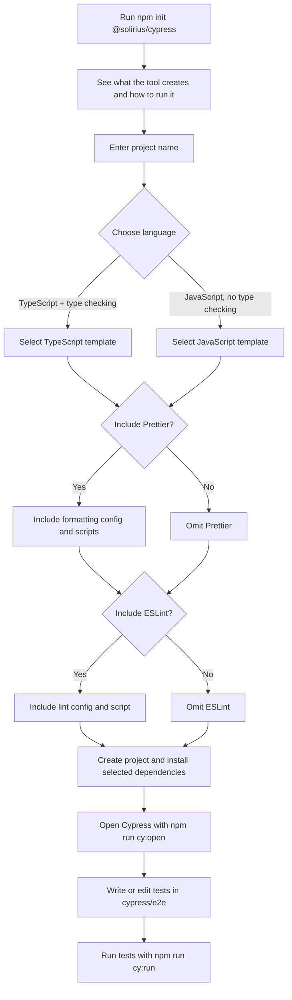

# Cypress Framework Scaffolder

Create a ready-to-run Cypress end-to-end testing project in a few prompts. Choose JavaScript or TypeScript, then decide whether to include Prettier and ESLint. TypeScript projects also include type checking.

## Features

- **Quick setup:** Generate a Cypress project from the command line.
- **Language choice:** Select JavaScript or TypeScript during setup.
- **Ready-to-run configuration:** Includes Cypress configuration and an example end-to-end test.
- **Optional ESLint and Prettier:** Choose whether to include either tool; selected tools are installed automatically with ready-to-use configuration and scripts.

## Getting Started

### Requirements

- Node.js 20 or later
- npm

### Create a project with npm

First, open a terminal at the root of an existing Git repository where you want the new project folder to live. Then run:

```sh
npm init @solirius/cypress
```

The CLI creates a new project folder inside the current repository. It asks for a project folder name, a language, and whether to include Prettier and ESLint:

- **TypeScript** creates `.ts` tests and configuration, and adds a `typecheck` script.
- **JavaScript** creates `.js` tests and does not add TypeScript or type checking.
- **Prettier** and **ESLint** are included by default. Choose **No** for either to omit its configuration, dependency, and npm scripts.

The CLI creates the project folder and installs Cypress and the dependencies you selected. When it finishes, change into the project directory:

```sh
cd my-cypress-project
```

### Open Cypress and run tests

Open the Cypress app to explore and run tests interactively:

```sh
npm run cy:open
```

The generated example test visits `https://example.cypress.io`. Edit it or add your own tests under `cypress/e2e/`. To run tests in headless mode:

```sh
npm run cy:run
```

To run headless tests in Chrome (requires Chrome installed):

```sh
npm run cy:run:chrome
```

## How it works



## Generated project structure

Every generated project includes Cypress configuration, an example end-to-end test, and these files. Tooling files are present only when you choose the corresponding option:

```text
my-cypress-project/
├── cypress/
│   ├── e2e/
│   │   └── home.cy.ts       # .js for JavaScript projects
│   └── support/
│       └── e2e.ts           # .js for JavaScript projects
├── .gitignore
├── .nvmrc
├── .prettierrc.json         # if Prettier is selected
├── eslint.config.mjs        # if ESLint is selected
├── cypress.config.ts        # .js for JavaScript projects
├── package.json
└── tsconfig.json            # TypeScript projects only
```

The Cypress configuration uses `https://example.cypress.io` as its base URL. Change `baseUrl` in `cypress.config.ts` or `cypress.config.js` to point tests at your application.

## Formatting and Type Checking

If you included Prettier, format the project with:

```sh
npm run format
```

Or check formatting without changing files:

```sh
npm run format:check
```

If you included ESLint, run the linter:

```sh
npm run lint
```

TypeScript projects can also check types:

```sh
npm run typecheck
```

## Contributing

Contributions are welcome. Please open an issue or submit a pull request with suggestions or improvements.

## License

This project is licensed under the MIT License.

## Publishing this CLI

Publishing uses a two-step process: GitHub Actions uploads a **staged release** to npm, then an authorised maintainer reviews and approves that stage. **A successful workflow run does not publish the package for users to install. The new version becomes available only after approval.**

Husky runs a local pre-commit check when you commit changes to files that trigger the publishing workflow. It checks the current package version against npm and blocks the commit if that version is already published. The check needs access to the npm registry; if the registry cannot be reached, it fails with an error rather than assuming the version is available. You can run it manually with `npm run check:published-version`.

The workflow in `.github/workflows/publish.yml` runs when changes to the CLI source, templates, build configuration, package manifests, or this README are pushed to `main`. Changes only to the workflow file or unrelated repository files do not trigger it. When triggered, it installs dependencies, checks that the package version has not already been published, and runs `npm stage publish` using npm Trusted Publishing. This uploads the package to npm's staged packages area without making it the public release.

### Release steps

1. **Choose a new version.** Update the `version` in both `package.json` and `package-lock.json`. npm does not allow the same version to be published twice.
2. **Push the release to `main`.** Commit the version bump along with the intended package changes.
3. **Wait for staging.** In the repository's GitHub **Actions** tab, confirm the publish workflow completed successfully. A failed run means there is no stage to approve. A successful run means the package is waiting for approval, not that it is already public.
4. **Review and approve the stage.** An authorised member of the `@solirius` npm scope must approve it with 2FA. Either:
   - On npmjs.com, open the `@solirius/create-cypress` package, go to **Staged Packages**, inspect the staged version, and select **Approve**.
5. **Verify publication.** After approval, confirm the released version with `npm view @solirius/create-cypress version`. Users can then run `npm init @solirius/cypress` to use the published package.

Do not leave a stage pending if you intend the release to be available: it remains unpublished until approved. Only members of the `@solirius` scope with 2FA can approve, so a workflow run alone cannot release a package to users.

### Trusted Publishing setup

Trusted Publishing must be configured in the npm settings for `@solirius/create-cypress`:

- Provider: GitHub Actions
- Organisation or user: `jperry189`
- Repository: `cypress-scaffold`
- Workflow filename: `publish.yml`
- Environment: leave unset unless you add an environment to the workflow
- Allowed actions: stage only (`npm stage publish`)

The workflow installs npm 11, because Trusted Publishing needs npm 11.5.1 or newer and `npm stage` needs a recent npm 11 release. Troubleshooting:

- `E404`: npm is too old, or the Trusted Publisher entry doesn't exactly match the owner, repository, and workflow filename above (all case-sensitive).
- `E403 - OIDC permission denied for this action`: the entry doesn't allow the action being run. A stage-only entry allows `npm stage publish` but not `npm publish`.

### Restricting who can publish

1. In the npm organization settings, require two-factor authentication for all members.
2. In the package's **Settings → Publishing access**, choose **Require two-factor authentication and disallow tokens**. Trusted Publishing keeps working because it uses short-lived OIDC credentials rather than tokens.
3. Limit who has write access to the package and protect this repository's `main` branch (for example, with branch protection).

### Manual publish

To bypass GitHub Actions, use an npm account with permission to publish to the `@solirius` scope and 2FA enabled, then run:

```sh
npm login
npm whoami
npm run build
npm publish --access public
```

If npm returns `EOTP`, retry with the current numeric code from your authenticator app:

```sh
npm publish --access public --otp=123456
```

Replace `123456` with your current code; it is not sent by email or text. Never commit or share an npm token or one-time code.

## Local development

To build the CLI from a local checkout (instead of using the published npm package):

```sh
cd /path/to/cypress-scaffold
npm install
npm run build
npm run format:check
```

Then run the built CLI from the parent directory where you want the generated project created:

```sh
node /path/to/cypress-scaffold/bin/cli.js
```

Replace `/path/to/cypress-scaffold` with the checkout's actual path.
