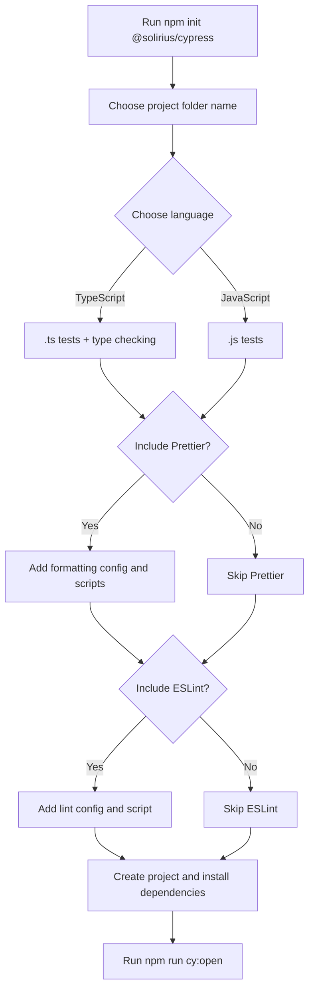

# Cypress Framework Scaffolder

Create a ready-to-run Cypress end-to-end testing project in a few prompts. Choose JavaScript or TypeScript, then decide whether to include Prettier and ESLint. TypeScript projects also include type checking.

## Quick start

- Node.js 20 or later
- npm

From the root of the existing Git repository where you want the project created, run:

```sh
npm init @solirius/cypress
```

The command prompts for a project folder name, JavaScript or TypeScript, and whether to include Prettier and ESLint. It creates that folder inside the current repository and installs its dependencies. **Run it inside the repository you want to use**; running it elsewhere creates the project outside that repository.

You don't need to use `@latest`. When the command finishes, it clears npm's npx cache (`~/.npm/_npx`), so the next run downloads the newest version. This clears cached npx packages for other tools too; npx re-downloads them the next time they're run. The cache is cleared after the run, so if you have an older copy cached from before this behaviour existed, delete `~/.npm/_npx` once.

When setup finishes, enter the new project:

```sh
cd my-cypress-project
```

## Setup options

The CLI walks through these choices, then creates the project and installs its dependencies:



## Run Cypress

Open the Cypress app:

```sh
npm run cy:open
```

The example test visits `https://example.cypress.io`. Add or edit tests in `cypress/e2e/`. Run tests headlessly with:

```sh
npm run cy:run
```

To run headlessly in Chrome (Chrome must be installed):

```sh
npm run cy:run:chrome
```

## Generated project structure

TypeScript adds `.ts` tests, configuration, and a `typecheck` script. JavaScript uses `.js` tests and does not include type checking. Prettier and ESLint are included by default; choose **No** during setup to omit either tool.

Each project includes Cypress configuration and an example test. Optional tool files and `tsconfig.json` are included only when applicable:

```text
my-cypress-project/
├── cypress/
│   ├── e2e/
│   │   └── home.cy.ts       # .js for JavaScript projects
│   └── support/
│       └── e2e.ts           # .js for JavaScript projects
├── .gitignore
├── .nvmrc
├── .prettierrc.json         # if Prettier is selected
├── eslint.config.mjs        # if ESLint is selected
├── cypress.config.ts        # .js for JavaScript projects
├── package.json
└── tsconfig.json            # TypeScript projects only
```

The default `baseUrl` is `https://example.cypress.io`. Change it in `cypress.config.ts` or `cypress.config.js` to point to your application.

### Optional checks

Run these scripts if you selected the matching tools:

```sh
npm run format
npm run format:check
npm run lint
npm run typecheck
```

## Contributing

Contributions are welcome. Please open an issue or submit a pull request with suggestions or improvements.

## License

This project is licensed under the MIT License.

## Publishing this CLI

Publishing uses a two-step process: GitHub Actions uploads a **staged release** to npm, then an authorised maintainer reviews and approves that stage. **A successful workflow run does not publish the package for users to install. The new version becomes available only after approval.**

Husky runs a local pre-commit check when you commit changes to files that trigger the publishing workflow. It checks the current package version against npm and blocks the commit if that version is already published. The check needs access to the npm registry; if the registry cannot be reached, it fails with an error rather than assuming the version is available. You can run it manually with `npm run check:published-version`.

The workflow in `.github/workflows/publish.yml` runs when changes to the CLI source, templates, build configuration, package manifests, or this README are pushed to `main`. Changes only to the workflow file or unrelated repository files do not trigger it. When triggered, it installs dependencies, checks that the package version has not already been published, and runs `npm stage publish` using npm Trusted Publishing. This uploads the package to npm's staged packages area without making it the public release.

### Release steps

1. In your pull request, increment the version in both `package.json` and `package-lock.json`. The Husky pre-commit check blocks commits that change release-triggering files—including this README—without a version bump, with mismatched package versions, or with a version already published to npm. It needs npm registry access; run `npm run check:published-version` to check manually.
2. Get the pull request reviewed and approved, then merge it to `main`. Changes to the CLI source, templates, build configuration, package manifests, or this README trigger `.github/workflows/publish.yml`.
3. Check GitHub **Actions** for a successful workflow run. It stages the package on npm; it does **not** make the release public.
4. An authorized `@solirius` maintainer reviews the staged version on npmjs.com under **Staged Packages** and approves it with 2FA. Approval publishes the release.
5. Verify the release with `npm view @solirius/create-cypress version`. Users can then run `npm init @solirius/cypress`.

If staging fails, resolve the workflow error first. If the version is already published, increment it in both package files and submit the update through a new pull request.

## Local development

To build the CLI from a local checkout (instead of using the published npm package):

```sh
cd /path/to/cypress-scaffold
npm install
npm run build
npm run format:check
```

Then run the built CLI from the parent directory where you want the generated project created:

```sh
node /path/to/cypress-scaffold/bin/cli.js
```

Replace `/path/to/cypress-scaffold` with the checkout's actual path.
