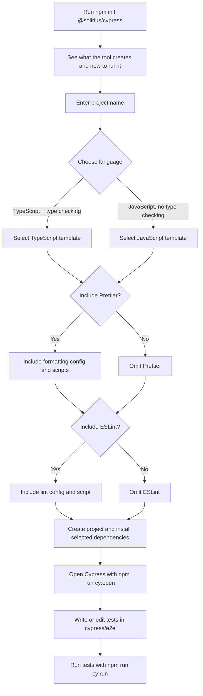

# Cypress Framework Scaffolder

Create a ready-to-run Cypress end-to-end testing project in a few prompts. Choose JavaScript or TypeScript, then decide whether to include Prettier and ESLint. TypeScript projects also include type checking.

## Features

- **Quick setup:** Generate a Cypress project from the command line.
- **Language choice:** Select JavaScript or TypeScript during setup.
- **Ready-to-run configuration:** Includes Cypress configuration and an example end-to-end test.
- **Optional ESLint and Prettier:** Choose whether to include either tool; selected tools are installed automatically with ready-to-use configuration and scripts.

## Getting Started

### Requirements

- Node.js 20 or later
- npm

### Create a project with npm

Run this in the parent directory where you want your new project folder created:

```sh
npm init @solirius/cypress
```

The CLI asks for a project name, a language, and whether to include Prettier and ESLint:

- **TypeScript** creates `.ts` tests and configuration, and adds a `typecheck` script.
- **JavaScript** creates `.js` tests and does not add TypeScript or type checking.
- **Prettier** and **ESLint** are included by default. Choose **No** for either to omit its configuration, dependency, and npm scripts.

The CLI creates the project folder and installs Cypress and the dependencies you selected. When it finishes, change into the project directory:

```sh
cd my-cypress-project
```

### Open Cypress and run tests

Open the Cypress app to explore and run tests interactively:

```sh
npm run cy:open
```

The generated example test visits `https://example.cypress.io`. Edit it or add your own tests under `cypress/e2e/`. To run tests in headless mode:

```sh
npm run cy:run
```

To run headless tests in Chrome (requires Chrome installed):

```sh
npm run cy:run:chrome
```

## How it works



## Generated project structure

Every generated project includes Cypress configuration, an example end-to-end test, and these files. Tooling files are present only when you choose the corresponding option:

```text
my-cypress-project/
├── cypress/
│   ├── e2e/
│   │   └── home.cy.ts       # .js for JavaScript projects
│   └── support/
│       └── e2e.ts           # .js for JavaScript projects
├── .gitignore
├── .nvmrc
├── .prettierrc.json         # if Prettier is selected
├── eslint.config.mjs        # if ESLint is selected
├── cypress.config.ts        # .js for JavaScript projects
├── package.json
└── tsconfig.json            # TypeScript projects only
```

The Cypress configuration uses `https://example.cypress.io` as its base URL. Change `baseUrl` in `cypress.config.ts` or `cypress.config.js` to point tests at your application.

## Formatting and Type Checking

If you included Prettier, format the project with:

```sh
npm run format
```

Or check formatting without changing files:

```sh
npm run format:check
```

If you included ESLint, run the linter:

```sh
npm run lint
```

TypeScript projects can also check types:

```sh
npm run typecheck
```

## Contributing

Contributions are welcome. Please open an issue or submit a pull request with suggestions or improvements.

## License

This project is licensed under the MIT License.

## Publishing this CLI

The GitHub Actions workflow at `.github/workflows/publish.yml` automatically publishes to npm when changes affecting the published package are pushed to `main`. It watches the CLI source, templates, build configuration, package manifests, and this README; changes only to the workflow or unrelated repository files do not trigger a publish.

Before each publish, increment the version in both `package.json` and `package-lock.json`. npm does not allow publishing the same version twice. Commit the version bump together with the package changes and push to `main`. The workflow checks that the version is new, builds the CLI, and publishes it using npm Trusted Publishing.

Trusted Publishing must be configured in the npm settings for `@solirius/create-cypress`:

- Provider: GitHub Actions
- Organisation or user: `jperry189`
- Repository: `cypress-scaffold`
- Workflow filename: `publish.yml`
- Environment: leave unset unless you add an environment to the workflow

For a manual publish instead of using GitHub Actions, use an npm account with permission to publish to the `@solirius` scope. Enable two-factor authentication for publishing in your npm account settings, then run:

```sh
npm login
npm whoami
npm run build
npm publish --access public
```

If npm returns `EOTP`, retry with the current numeric code from your authenticator app:

```sh
npm publish --access public --otp=123456
```

Replace `123456` with your current code; it is not sent by email or text. Never commit or share an npm token or one-time code.

## Local development

To build the CLI from a local checkout (instead of using the published npm package):

```sh
cd /path/to/cypress-scaffold
npm install
npm run build
npm run format:check
```

Then run the built CLI from the parent directory where you want the generated project created:

```sh
node /path/to/cypress-scaffold/bin/cli.js
```

Replace `/path/to/cypress-scaffold` with the checkout's actual path.
