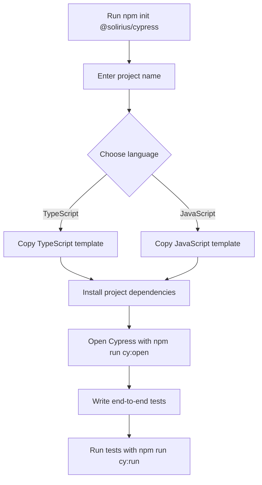

# `@solirius/create-cypress`

`@solirius/create-cypress` is a command-line project generator for creating a ready-to-run Cypress end-to-end testing project. It helps you get from an empty directory to a runnable Cypress setup without manually creating configuration, installing Cypress, or wiring up scripts.

```sh
npm init @solirius/cypress
```

Choose a project name and TypeScript or JavaScript. The CLI copies the matching template, installs its dependencies, and prints the command to start Cypress.

## How it works



For example, to create and run a project:

```sh
npm init @solirius/cypress
# Enter "my-cypress-project" and choose TypeScript or JavaScript
cd my-cypress-project
npm run cy:open
# Create or edit tests in the Cypress e2e folder
npm run cy:run
```

The generated project includes Cypress configuration, an example end-to-end test against `example.cypress.io`, and Prettier formatting. TypeScript projects also include a type-checking script.

## Formatting

Generated projects include Prettier and a shared configuration. Format the project with:

```sh
npm run format
```

Check formatting without changing files:

```sh
npm run format:check
```

## Publishing this CLI

The GitHub Actions workflow at `.github/workflows/publish.yml` builds and publishes the package to npm on every push to `main`. Increment the `version` in `package.json` before pushing; npm does not allow publishing the same package version twice.

This workflow uses npm Trusted Publishing with GitHub OIDC and requires no npm access token. Before the first publish, configure a trusted publisher for the `@solirius/create-cypress` package in npm:

- Provider: GitHub Actions
- Organisation or user: `jperry189`
- Repository: `cypress-scaffold`
- Workflow filename: `publish.yml`
- Environment: leave unset unless you add an environment to the workflow

The npm package must already exist under the `@solirius` scope, and the GitHub repository must match the configured publisher. Publishing also requires npm's provenance support and a sufficiently recent npm CLI (provided by Node 22 here).

## Local development

```sh
npm install
npm run build
npm run format:check
```
